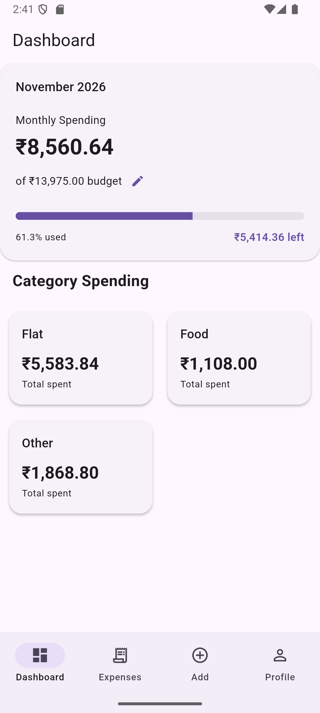
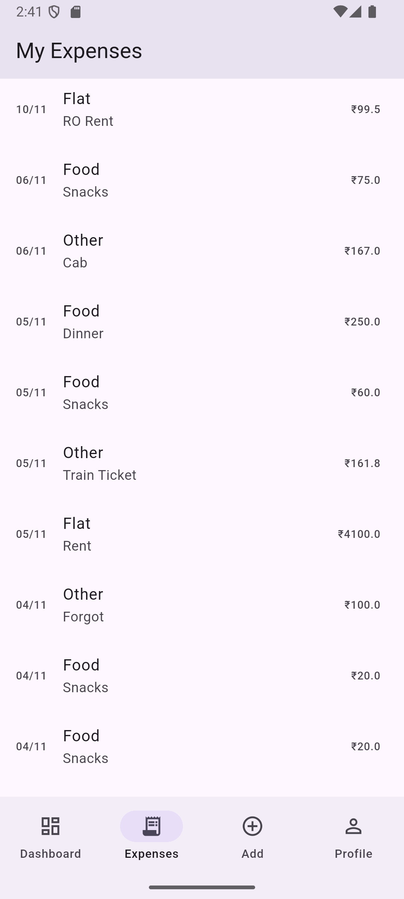
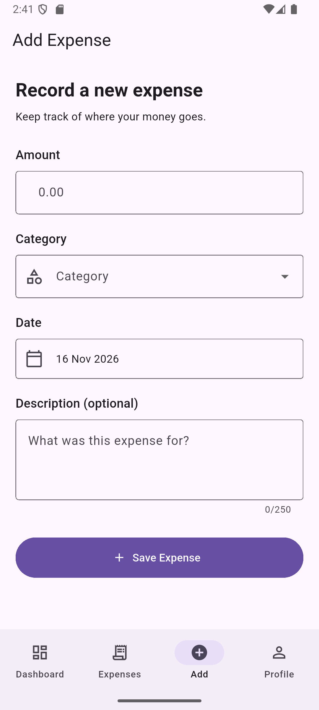
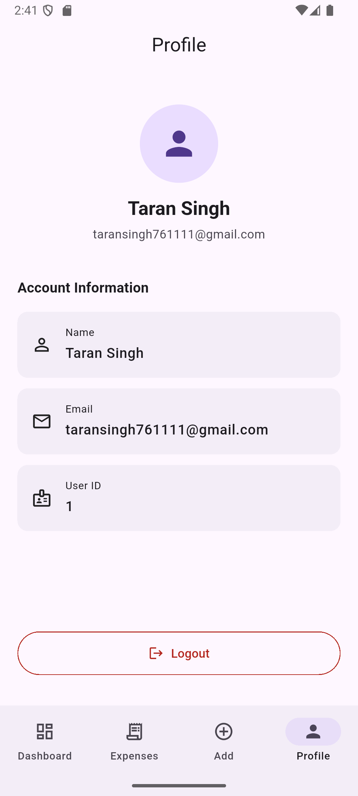

# SpendLens – Personal Expense Tracker

A full-stack personal finance management application built using **Flutter and Java Spring Boot**. SpendLens helps users manage daily expenses, set monthly budgets, and track spending patterns through an interactive dashboard.

The application follows **Clean Architecture** principles with BLoC state management, RESTful API integration, and JWT-based authentication.


## 📱 Screenshots







## ✨ Features

### Dashboard & Budget Management

- Monthly spending overview.
- Set and update monthly budgets.
- Visual representation of budget utilization.
- Display remaining budget and total expenditure.
- Category-wise spending summaries.

### Expense Management

- Add and manage personal expenses.
- Categorize expenses for better organization.
- Record expense amounts, dates, and descriptions.
- View expense history.
- Retrieve user-specific expense records.

### Authentication & Security

- User registration and login.
- JWT-based authentication and authorization.
- Password encryption using BCrypt.
- Secure access and refresh token storage.
- Protected backend endpoints using Spring Security.

### Profile Management

- Display user account information.
- View registered name, email, and user ID.
- Secure logout functionality.

## 🛠️ Tech Stack

| Category         | Technologies                             |
| ---------------- | ---------------------------------------- |
| Frontend         | Flutter, Dart                            |
| Backend          | Java, Spring Boot                        |
| State Management | BLoC                                     |
| Architecture     | Clean Architecture                       |
| API Integration  | Dio, REST APIs, JSON                     |
| Database         | SQL, Spring Data JPA, Hibernate          |
| Authentication   | Spring Security, JWT, BCrypt             |
| Secure Storage   | Flutter Secure Storage                   |
| Code Generation  | Freezed, json_serializable, build_runner |
| Version Control  | Git, GitHub                              |

## 🏗️ Architecture

### Flutter Application

The frontend follows Clean Architecture with three primary layers:

- **Presentation Layer:** Flutter UI components, BLoC, events, and states.
- **Domain Layer:** Business logic, entities, and repository interfaces.
- **Data Layer:** Data models, remote data sources, API communication, and repository implementations.

### Spring Boot Backend

The backend follows a layered architecture:

- **Controller Layer:** Handles HTTP requests and API responses.
- **Service Layer:** Implements application business logic.
- **Repository Layer:** Handles database operations using Spring Data JPA.
- **Entity Layer:** Defines database entities and relationships.
- **Security Layer:** Manages JWT authentication and authorization.

## 📂 Project Structure

```text
lib/
├── core/
│
├── features/
│   ├── auth/
│   │   ├── data/
│   │   ├── domain/
│   │   └── presentation/
│   │
│   ├── dashboard/
│   │   ├── data/
│   │   ├── domain/
│   │   └── presentation/
│   │
│   ├── expenses/
│   │   ├── data/
│   │   ├── domain/
│   │   └── presentation/
│   │
│   ├── budget/
│   │   ├── data/
│   │   ├── domain/
│   │   └── presentation/
│   │
│   └── profile/
│       └── presentation/
│
└── main.dart
```

## 🚀 Getting Started

### Prerequisites

- Flutter SDK
- Dart SDK
- Java JDK
- Maven
- SQL database
- Android Studio or VS Code

### 1. Clone the Repository

```bash
git clone https://github.com/TaranSingh-111/SpendLens.git

cd SpendLens
```

### 2. Install Dependencies

```bash
flutter pub get
```

### 3. Configure Backend

Clone and configure the Spring Boot backend.

**Backend Repository:** [SpendLens Backend](https://github.com/TaranSingh-111/SpendLens-backend)

Configure the API base URL in the Flutter application.

For Android Emulator:

```text
http://10.0.2.2:8080
```

For a physical Android device, use your computer's local network IP address.

Ensure the backend and database are running before launching the application.

### 4. Run the Application

```bash
flutter run
```

## 🔮 Future Improvements

- Interactive expense analytics and charts.
- Advanced expense filtering and search.
- Recurring expense management.
- Export expense reports to PDF and CSV.
- Budget threshold notifications.
- Detailed monthly and yearly spending reports.

## 👨‍💻 Author

**Taran Singh**

- GitHub: [TaranSingh-111](https://github.com/TaranSingh-111)

---

<p align="center">
  <b>SpendLens</b> — Track your expenses. Understand your spending. Manage your money.
</p>